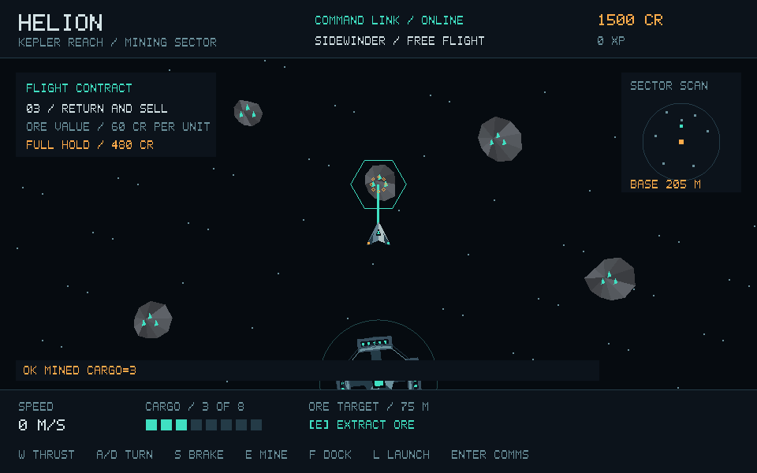
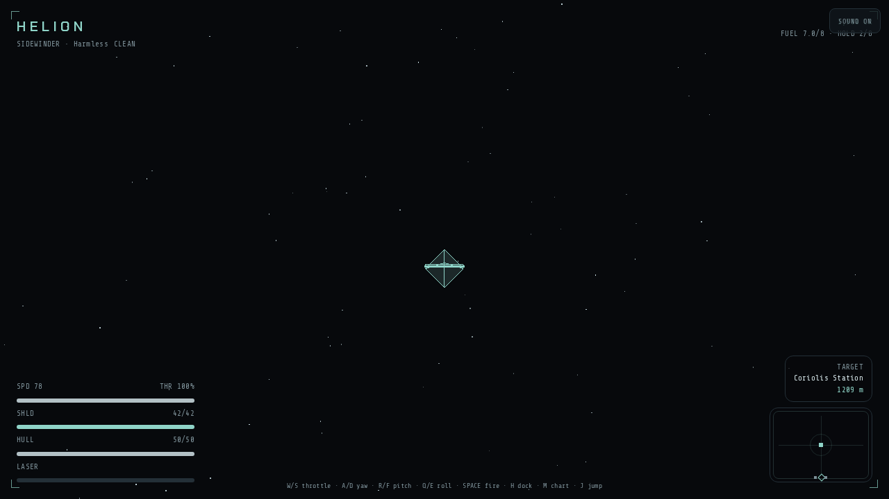
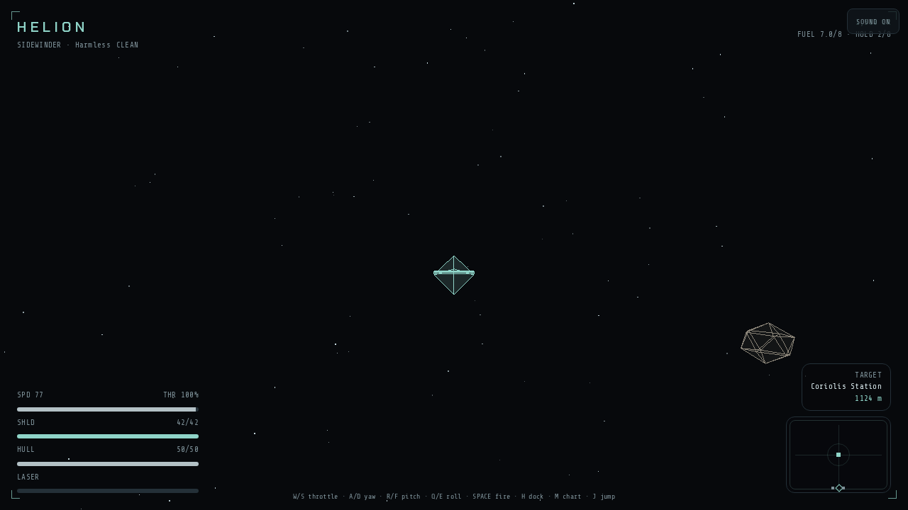

# Helion

Helion is a native, server-authoritative, persistent online science-fiction
game in active alpha development. Its implementation and release baseline is the
C++17 TLS server and SDL2/OpenGL client under `native/`, designed for Linux systems with OpenGL
2.1-era hardware, including older Intel integrated graphics. The Three.js /
TanStack application under `src/` is retained as a legacy design reference; it
is not a peer authority path or the production game architecture.

The native runtime now provides a playable Kepler career arc, procedural
ship/station/asteroid assets, account creation/login, durable commander
profiles, shared chat, and mandatory verified TLS transport. Linux packages
and a desktop local-play launcher/helper are available. The helper starts a local
DEVELOPMENT server and client; the future full player launcher with account flow,
authorized environment selection, updates/repair, STABLE/TEST channels, news/status
and patch management is not implemented. See the
[alpha-readiness plan](docs/development/ALPHA_READINESS.md). Separate server/client packages
support a [Compaq 610 + EliteBook 8460p setup](docs/compaq610-server-elitebook-client.md).
See [installation](docs/native-install.md) and
[project state](docs/PROJECT_STATE.md). Current lore authority is
[World Bible DraftComp8](docs/lore/HELION_World_Bible_draftcomp8.txt), with the
[v0.21 canon checksum](docs/lore/HELION_CANON_CHANGELOG_AI_SYNC_v0.21.txt).
The World Bible controls canon; repository source/tests and the
[execution record](docs/development/BATCH14_EXECUTION.md) establish implementation
truth. Batch 14 **M0–M8 are complete**; **M9 is not started**. Batch 14 is
not complete, and Batch 15 is not started. The execution record contains M8's
starting checkpoint, acceptance evidence and recovery boundaries. M9 requires
separate authorization.

Current canon begins in **1087 AS**, exactly **900 years after the Severance**
(187 AS). Known Space has exactly **200 persistent systems**: **120
faction-controlled** and **80 Zero Space**. Inter-Galactic Governance (IGG) is a
non-sovereign treaty/service framework; UniNet is the information network and
Galactic Standard Credit (GSC) the currency. Crownspire, Ironstar Forge and
Verdance are current canon names. Future Riftspace lies outside the 200-system
count. Lore and future systems are not claims of current playable scope.

Operator references: [Production operations](docs/production-operations.md),
[PRIVATE TEST administration](docs/private-test-admin.md),
[native installation](docs/native-install.md),
[server installation/configuration](docs/native-server.md) and
[client installation](docs/native-client.md).

## Native development screenshots

These are screenshots captured from the native SDL/OpenGL client rather than
presentation/concept renders. They are development-state evidence, not a claim
that the final art direction or UI is complete.

| Native mining | Station interface | Flight approach |
| --- | --- | --- |
|  |  |  |

## Repository layout

| Path | Purpose |
| --- | --- |
| `src/` | Legacy browser reference; not the authoritative release runtime |
| `native/server/` | Standalone POSIX TCP server |
| `native/client/` | Standalone SDL2/OpenGL client |
| `native/README.md` | Native quick start and protocol reference |
| `docs/installation.md` | Complete source, package, server, and client installation guide |
| `docs/native-server.md` | Server installation and production configuration |
| `docs/native-client.md` | Client installation, launcher usage, and graphics troubleshooting |
| `migrations/` | Browser database migrations |
| `CMakeLists.txt` | Native build entry point |
| `startup.sh` | Browser preview startup contract |

## Legacy browser-reference development

Requirements: Node.js 22 or newer and npm.

```sh
npm install
npm run dev
```

Open the preview served by the development environment. Useful checks:

```sh
npm run typecheck
npm run test
npm run build
```

This path exists for historical reference and isolated UI experimentation.
Its local or database-backed state is not part of the canonical native
universe.

## Quick start: standalone native runtime

On Debian/Ubuntu, install the native build dependencies:

```sh
sudo apt install build-essential cmake libsdl2-dev libgl1-mesa-dev libssl-dev python3 openssl
```

Build from the repository root:

```sh
cmake -S . -B build-native -DCMAKE_BUILD_TYPE=Release
cmake --build build-native --parallel
```

Start the server:

```sh
native/scripts/helion-dev-cert /tmp/helion-local-tls
./build-native/native/helion_server 4242 helion-server.db \
  --environment development \
  --cert /tmp/helion-local-tls/server.crt --key /tmp/helion-local-tls/server.key
```

Connect with the graphical client:

```sh
./build-native/native/helion_client 127.0.0.1 4242 --ca /tmp/helion-local-tls/server.crt
```

For protocol diagnostics without a graphical session:

```sh
./build-native/native/helion_client 127.0.0.1 4242 --ca /tmp/helion-local-tls/server.crt --terminal
```

See the [native server guide](docs/native-server.md) and
[native client guide](docs/native-client.md) for service setup, firewall
configuration, data-file handling, and troubleshooting.

## Native protocol snapshot

The graphical client negotiates M4 binary version 1 over TLS. Terminal mode and
explicit `--legacy-protocol` use bounded text; there is no silent downgrade.
See the [transport contract](docs/development/BATCH14_PROTOCOL.md).
These commands are newline-terminated in legacy mode and carried as text-request
payloads in binary mode (flight input also has a typed binary message):

```text
CREATE username password display
LOGIN username password
COMPANION ISSUE
COMPANION AUTH bearer-token
COMPANION LIST
COMPANION REVOKE token-id
CHAT message
PROFILE
STATE
SHIPYARD LIST
SHIPYARD OWNED
SHIPYARD BUY TITAN_MULE
LAUNCH
INPUT 1 0 0
FLIGHT
MINE
FIRE
DOCK
QUIT
```

The native server stores salted scrypt password hashes and requires TLS 1.2+
for all connections. Scoped companion bearer credentials can be issued from a
normal player session; only their SHA-256 verifiers are persisted, they expire
after 30 days, and their initial authority is limited to `profile.read`.
See [companion authentication](docs/companion-auth.md). Clients verify certificate trust and server identity;
there is no plaintext fallback. Live player and NPC contacts are replicated,
while shared asteroid depletion, player-to-player collision, and
cross-connection/IP rate limiting remain future work.

## Graphics compatibility

The client supports both an OpenGL 3.3 core shader renderer and a fixed-function
compatibility renderer with an OpenGL 2.1 fallback. A 960×600 window is created
by default and can be resized. Startup diagnostics identify hardware or
software rendering and the selected context.

## Current gameplay scope

The native game currently provides account persistence, the Kepler career
slice, mining, station markets, missions, upgrades and modules, combat and
recovery, reputation, UniNet events, live contacts, persistent owned ships, distinct
hull performance, and authoritative Kepler/Cinder shipyards. Later World Bible
systems remain future native work unless the project-state documentation says
otherwise. Current executables still use some superseded display labels; wire/save
identifiers such as `GALNET`, `credits` and `TITAN_MULE` remain compatible. See the
[v0.21 reconciliation](docs/development/HELION_CANON_AND_DOC_RECONCILIATION_v0.21.md)
for the distinction between current canon, display cleanup and stable identifiers.

## License and contribution

This repository is evolving incrementally. Keep changes focused, preserve the
OpenGL 2.1 compatibility target, and run the native CMake validation relevant
to every native change. Run browser checks when modifying the legacy `src/`
reference, but do not use browser behavior as evidence of native completion.

## M8 release and upgrade workflow

See [native release/deployment/recovery](docs/release-deployment.md) for 0.2.1 build identity,
STABLE/TEST artifact channels, installed manifests, package inspection, TEST-first
rehearsal and verified backup-before-upgrade. Production restore remains offline
verification/planning; no destructive restore or M9 completion is claimed.
